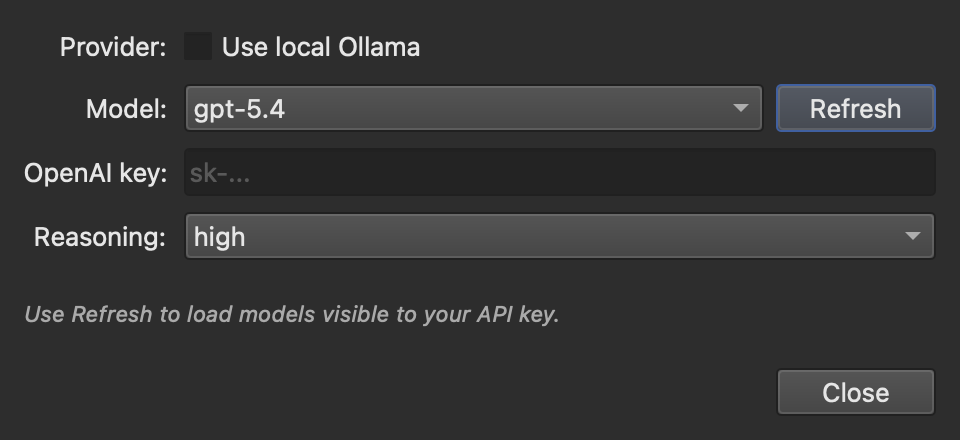
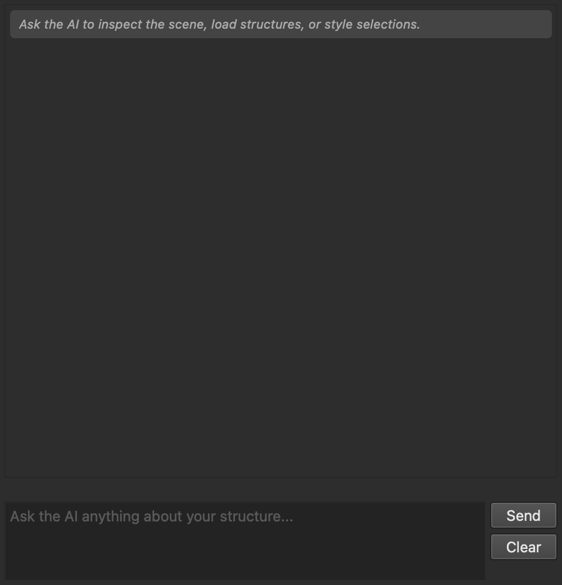

# PyMOL Open Source

PyMOL is a molecular visualization tool for loading, styling, analyzing, and
rendering molecular structures. This checkout includes the Qt AI Assistant for
running PyMOL commands with either OpenAI models or local Ollama models.

## Install

Use a Python environment with Qt and the build dependencies installed, then run:

```bash
pip install .
```

On this macOS conda setup, the working install command is:

```bash
PREFIX_PATH=/opt/homebrew \
python -m pip install --no-build-isolation --config-settings vmd-plugins=false .
```

`vmd-plugins=false` disables optional VMD molfile plugins that require NetCDF
headers. The main PyMOL app and AI Assistant still work.

## Run

```bash
pymol
```

For a quiet/headless smoke test:

```bash
python - <<'PY'
import pymol
pymol.finish_launching(["pymol", "-cq"])
from pymol import cmd
print(cmd.get_version()[0])
cmd.quit()
PY
```

## AI Setup

Install the client library for the provider you want to use. `keyring` is
optional and lets PyMOL remember your API keys in the system keychain; without
it, keys last until PyMOL closes.

```bash
pip install openai anthropic keyring
```

Then launch PyMOL and open:

- `AI -> AI Settings...` to choose the provider/model and enter an API key
- `AI -> AI Assistant...` to open the chat panel



### OpenAI

In `AI Settings`, enter your API key or set it before launching PyMOL:

```bash
export OPENAI_API_KEY=your_api_key_here
```

Click `Refresh` to load the OpenAI models available to that key, then choose a
model from the picker.

### Anthropic Claude

Choose `Anthropic Claude` as the provider in `AI Settings`, then enter your API
key or set it before launching PyMOL:

```bash
export ANTHROPIC_API_KEY=your_api_key_here
```

### Local Ollama

Start Ollama locally:

```bash
ollama serve
```

Install a model that supports both vision and tools, then choose `Local
Ollama` as the provider in `AI Settings`. The picker only shows installed Ollama models whose
metadata advertises both `vision` and `tools`.

## Use The Assistant

Open `AI -> AI Assistant...`, type a request, and press Enter. Shift+Enter adds
a new line, and the Up and Down arrows recall earlier messages.



The assistant can:

- inspect the current PyMOL scene
- run PyMOL commands
- capture the viewport for visual context
- inspect selections and measure distances, angles, dihedrals and contacts
- search the Protein Data Bank and UniProt
- load predicted structures from AlphaFold DB
- look up bundled PyMOL command documentation

The panel also has:

- preset prompts for common views
- `Undo AI turn`, which restores the scene to before the last AI turn
- `Export .pml`, which saves the commands the AI ran as a script
- a request for approval before risky commands, such as deleting objects,
  overwriting files, or running Python. This is a guardrail and not a sandbox
- drag and drop to load structure files
- a token count for the last turn and the session

## Useful Files

- AI chat UI: `modules/pmg_qt/ai_panel.py`
- AI tool loop and model discovery: `modules/pmg_qt/ai_agent.py`
- Claude provider: `modules/pmg_qt/ai_provider_claude.py`
- Qt menu entry: `modules/pymol/_gui.py`

## License

Copyright (c) [Schrodinger, LLC](https://www.schrodinger.com/)

Published under a BSD-like license. See [LICENSE](LICENSE).
